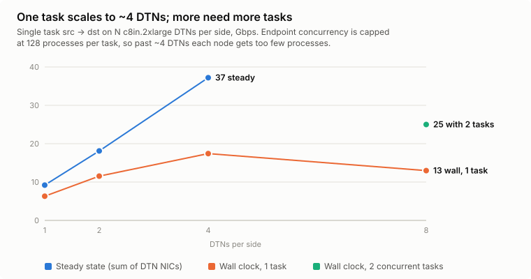
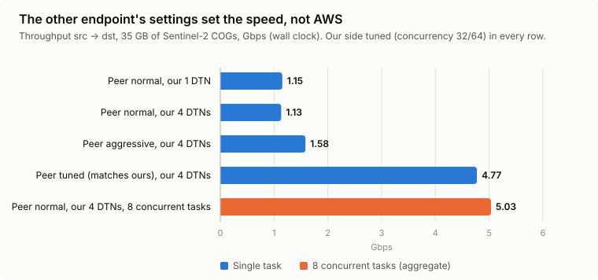
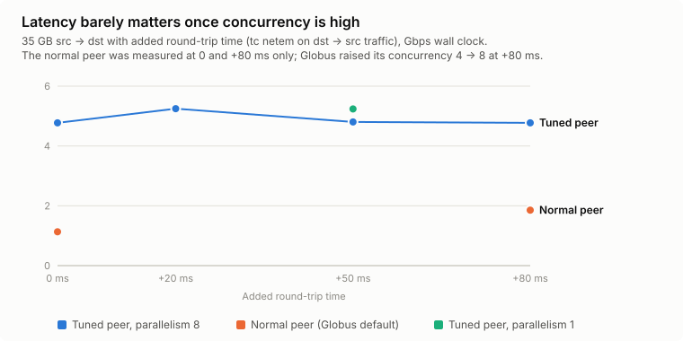

# It's not the cloud, it's the settings: what limits a Globus transfer on AWS

*Draft, November 2026. Data and method: [Performance](../performance/README.md).*

When a Globus transfer to or from the cloud is slow, the usual assumption is that
the cloud is the problem. We measured it, and in our tests it wasn't.

We run [Elastic GCS](../../README.md), a Globus Connect Server v5 deployment on AWS
that keeps its data transfer nodes (DTNs) stopped in a warm pool and starts them
when there's demand. It fronts the AWS Open Data Registry, so any researcher with a
Globus account can pull public datasets. To find out what actually sets the speed,
we stood up two independent deployments in us-west-2. One read Sentinel-2, NREL
and NASA POWER data from the Registry. The other wrote it into an S3 bucket in the
same region. We controlled both ends, which let us play each side in turn.

## One DTN: 9.2 Gbps. Four: 37 Gbps.

A single `c8in.2xlarge` DTN ($0.54/hour) moved Sentinel-2 imagery at **9.2 Gbps**
sustained, with 32 files in flight. That works out to about $0.13 of instance
time per TB.

Adding nodes scaled almost perfectly: 18.1 Gbps on two DTNs per side, and
**37.2 Gbps** on four. The cloud side wasn't the limit.



Past four nodes, one task stops getting faster. Globus Transfer caps a task at 128
files in flight, so eight DTNs get only 16 processes each. A second task fills
the rest: two concurrent tasks on eight DTNs reached 25 Gbps aggregate on wall
clock, including startup and the checksum tail.

## The other endpoint's settings decide

Then we played the remote endpoint, left at Globus's default `network_use` of
`normal`. Globus sets a task's concurrency to the *lower* of the two endpoints'
maximums, so a `normal` peer gets four files in flight.

| Peer setting | Our DTNs | Throughput, one task |
|---|---|---|
| `normal` (the default) | 1 | 1.15 Gbps |
| `normal` | **4** | 1.13 Gbps |
| `aggressive` | 4 | 1.58 Gbps |
| tuned (custom 32/64) | 4 | 4.77 Gbps |



Quadrupling our side changed nothing: 1.15 Gbps became 1.13. Changing one setting
on the *other* side quadrupled the speed.

That doesn't make elastic capacity pointless. Eight concurrent tasks against the
same default peer moved **5.0 Gbps** aggregate, 4.4× a single task. More DTNs
don't make one capped task faster, but they let many users go at full speed at
once, which is the point of an elastic endpoint.

## Data shape matters as much as bandwidth

Globus moves one file per process. That makes the size and count of files a
first-order effect:

- **One 111 GB file** moved at about **75 MB/s** on any instance size. One file
  is one process. Split into 32 parts, it moves in about two minutes instead of
  twenty-five.
- **Tiny files** (a Zarr store of 35 KB chunks) are bound by per-file overhead, at
  about 175 files/s. Written too fast into a fresh S3 prefix, they draw S3
  `SlowDown` errors, and Globus pauses the task.
- **Tens to hundreds of MB per file** is the sweet spot: about 0.3 Gbps per file
  in flight, scaling with concurrency.

## Things that turned out not to matter

- **Latency.** We added up to 80 ms of round-trip time with `tc netem`. At 32
  files in flight, throughput didn't move, even with a single TCP stream per file.

  

- **Checksum verification.** It cost about 3.5%. Leave it on.
- **Faster cores.** AMD's 5 GHz `m8azn` used about 40% less CPU per Gbps than
  Intel. But below 32 vCPUs most EC2 types are capped at 5 Gbps to the internet,
  while the network-optimized `*8in` families get their full baseline. The
  network limit picks the instance, not the CPU.

## What to do

**If you're a researcher:**
- Put many files in a task, and split very large datasets across several
  concurrent tasks.
- Package tiny files and split huge ones.
- Keep checksums on.

**If you run the endpoint on the other side:**
- Raise `network_use` from `normal`. This is the biggest lever.
  ```bash
  globus-connect-server endpoint update --network-use custom \
    --preferred-concurrency 32 --max-concurrency 64 \
    --preferred-parallelism 8 --max-parallelism 16
  ```
- Size it to what your own storage and network can sustain.

**If you run an elastic endpoint:**
- Size the pool for the number of concurrent tasks, not for bytes per second.
- Keep the control node out of the data path.
- Scale on the sum of concurrency across active tasks.

The [operator guide](../performance/operator-guide.md) has the details. The
[throughput model](../performance/throughput-model.md) predicts a task's speed
from these limits. On most of our runs it was within about 10%.

## How we measured

Two deployments of Elastic GCS 5.4.101 in us-west-2, talking over public IPs, so
EC2's internet-gateway limits applied as they would for a real remote user. The
sources were public Registry buckets (Sentinel-2 COGs, an NREL WIND Toolkit HDF5
file, a NASA POWER Zarr store). The sink was a private bucket in the same region.

Every run's raw log, the harness and the chart generator are in the repository.
The [methodology](../performance/methodology.md) covers the caveats: one region,
mostly single runs, and rates sampled over 20–80 s windows.
