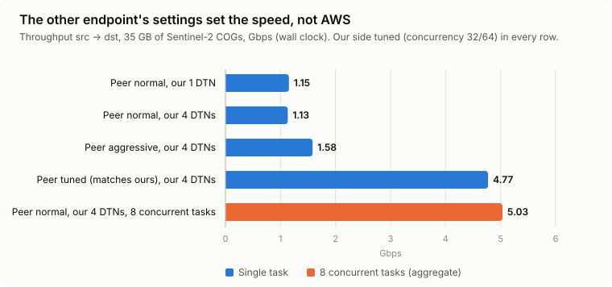

# Elastic GCS on AWS

Auto-scaling [Globus Connect Server v5](https://docs.globus.org/globus-connect-server/)
for AWS. Data transfer nodes (DTNs) wait stopped in a warm pool, costing only
their disks. They start when there's demand, and the endpoint serves from them
about two minutes later. When transfers finish, they stop again.

The driving use case is fronting the [AWS Open Data Registry](https://registry.opendata.aws/)
so any researcher with a Globus account can pull public datasets. The
infrastructure is generic, though: any Globus subscriber with data in S3 can use
it.

## What limits a transfer

**Short version: the cloud is rarely the bottleneck.** One `c8in.2xlarge` DTN
sustains about 9.2 Gbps, and one task scales linearly to about 37 Gbps on four.
What usually limits a transfer is the settings of the slower endpoint and the
shape of the data.

- [Performance overview](performance/README.md): the key findings.
- [Getting maximum performance](performance/user-guide.md): for researchers, and
  for admins of the endpoints on the other side.
- [Operator tuning](performance/operator-guide.md): for people running Elastic GCS.
- [Blog post](blog/2026-11-its-not-aws.md): the story in one read.

## Running it

- [Architecture](architecture.md): the cold, warm and hot tiers; node identities;
  lifecycle hooks.
- [Configuration](configuration.md) and [instance sizing](instance-sizing.md).
- [Operator guide](operator-guide.md) and
  [ephemeral control node](ephemeral-control-node.md), which covers idle cost.

The source, issues and raw benchmark data are on
[GitHub](https://github.com/scttfrdmn/aws-elastic-gcs).
