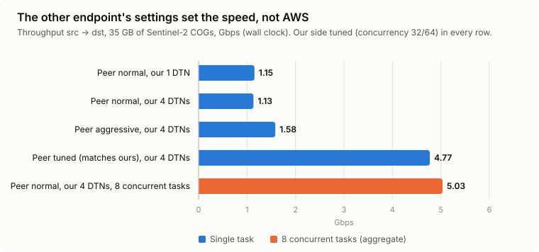
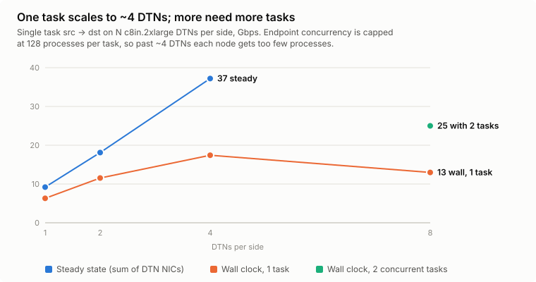
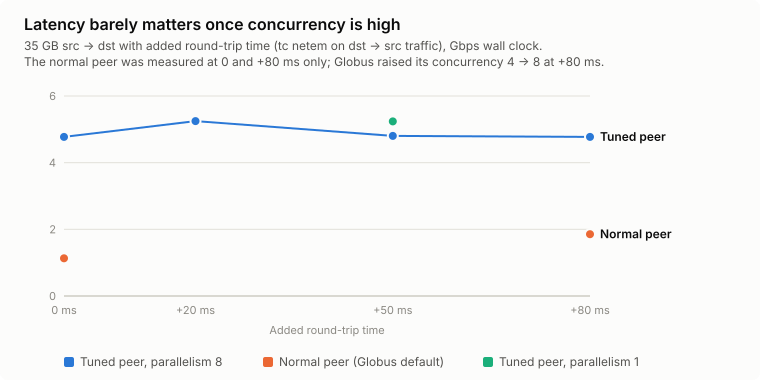

# Performance

What sets the speed of a Globus transfer to or from an Elastic GCS endpoint on
AWS, measured on real deployments in November 2026.

**Short version: the cloud is rarely the bottleneck.** A single c8in.2xlarge
data transfer node (DTN) sustains about **9.2 Gbps**, and a pool of them scales
linearly. What usually limits a transfer is the **settings of the slower
endpoint** (especially Globus's default `normal` network use) and the **shape of
the data** (file count and size).

| Guide | For |
|---|---|
| [Getting maximum performance](user-guide.md) | Researchers moving data to or from our endpoints, and admins of the endpoints on the other side |
| [Operator tuning](operator-guide.md) | People deploying and running Elastic GCS |
| [Throughput model](throughput-model.md) | Predicting throughput and DTN count; the calculator in `scripts/throughput_model.py` |
| [Methodology and results](methodology.md) | How the numbers were measured, with every run's data |

## Key findings

| Scenario (35 GB, 504 files) | Throughput |
|---|---|
| Peer at Globus default (`normal`), our 1 DTN | 1.15 Gbps |
| Peer at `normal`, our **4** DTNs | 1.13 Gbps |
| Peer `aggressive`, our 4 DTNs | 1.58 Gbps |
| Peer tuned to match ours, our 4 DTNs | 4.77 Gbps |
| Peer at `normal`, our 4 DTNs, **8 concurrent tasks** | 5.03 Gbps aggregate |

1. **The slower endpoint's settings cap every task.** Globus negotiates a task's
   concurrency as the *lower* of the two endpoints' maximums. A peer left at
   `normal` gets 4 concurrent files, about 1.1 Gbps, no matter how much capacity
   is on our side.
2. **Elastic DTNs pay off on aggregate demand.** More DTNs don't speed up a
   capped task, but they serve many users at once: 8 concurrent tasks against the
   same default peer moved 4.4× as much data per second.
3. **With both ends tuned, one task scales to about 4 DTNs.** Throughput grows
   linearly to ~37 Gbps steady state. Beyond that, Transfer's cap of 128
   concurrent processes per task leaves each node too few processes, and only
   concurrent tasks use the extra nodes.

   

4. **Data shape matters as much as bandwidth.**
   - **One huge file** moves at about 75 MB/s (0.6 Gbps) on any instance size,
     because one file is one process.
   - **Tiny files** are limited by per-file overhead (~175 files/s at
     concurrency 16), and writing them too fast into a new S3 prefix triggers
     S3 `SlowDown`.
   - **Medium files** (tens to hundreds of MB) move at ~0.3 Gbps per process,
     so they scale with concurrency.
5. **Latency is rarely the problem once concurrency is high.** Adding up to 80 ms
   of round-trip time didn't change throughput at concurrency 32, even with one
   TCP stream per file.

   

6. **Network limits choose the instance.** Most EC2 types under 32 vCPUs are
   capped at 5 Gbps to the internet. The `*8in` families get their full
   baseline. AMD's 5 GHz cores used ~40% less CPU per Gbps, but every AMD type in
   this size range hits the 5 Gbps cap.

   

7. **Checksum verification costs about 3.5%.** Keep it on.

Charts are generated from
[`test/benchmark/results/2026-11-us-west-2/summary.json`](../../test/benchmark/results/2026-11-us-west-2/summary.json)
by [`charts/make_charts.py`](charts/make_charts.py).
