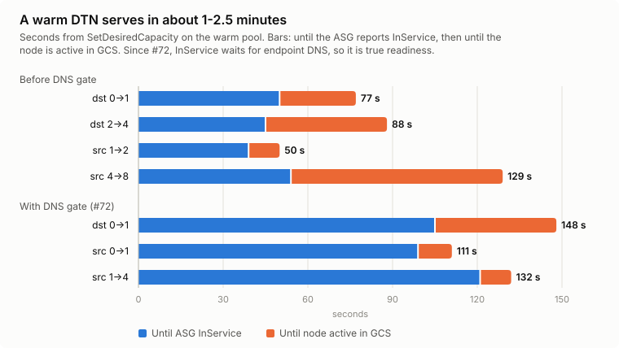

# Operator tuning

How to configure and run Elastic GCS for throughput, based on the November 2026
benchmarks. See [instance sizing](../instance-sizing.md) for instance choice, and
the [throughput model](throughput-model.md) for estimates.

## 1. Set network use explicitly

Nothing in the deployment sets the endpoint's network-use policy (#56), so a new
endpoint runs at Globus's `normal` preset: concurrency 4. That limited one
c8in.2xlarge DTN to about 0.35 Gbps.

| Setting (both ends) | Negotiated concurrency | Per-DTN steady state |
|---|---|---|
| `normal` | 4 | ~0.35 Gbps |
| `aggressive` | 8 | ~1.1–1.3 Gbps |
| `custom` 32/64, parallelism 8/16 | 32 | **~9.2 Gbps** (46% CPU) |

Recommended starting point: about 32 processes per DTN you expect a single task
to use, up to Transfer's limit of 128.

```bash
globus-connect-server endpoint update --network-use custom \
  --preferred-concurrency 32 --max-concurrency 64 \
  --preferred-parallelism 8 --max-parallelism 16
```

- **Gateways for tiny files** should get a lower override. At concurrency 128,
  tiny-object writes triggered S3 `SlowDown` at ~50 files/s; at 16 they ran
  ~175 files/s cleanly.
- **Transfer rejects** a max concurrency above 128.

## 2. Keep the control node out of the data path, but never at zero nodes

Globus spreads processes evenly across all active nodes. The t3a.large control
node (0.5 Gbps baseline) got the same share as a 12.5 Gbps DTN and ran at 75%
CPU, burning its burst credits.

- **When the first DTN is active:** disable the control node as a data node. It
  can still manage the endpoint through the DTNs.

  ```bash
  globus-connect-server node update <control-node-id> --disable --use-explicit-host <dtn-ip>
  ```

- **Before the last DTN leaves:** re-enable it.
- **The endpoint must never reach zero active nodes.** A disabled node's own GCS
  Manager refuses API calls, so with zero active nodes no node can re-enable
  itself or rejoin. Recovery is `globus-connect-server node setup
  --deployment-key ... --ip-address ...` on the control node (#69).
- **With the control node disabled,** management commands must target a live DTN
  (`--use-explicit-host <dtn-ip>`). Pointing them at the control node returns
  `service_unavailable`.

Automating this toggle is part of the slot controller (#65).

## 3. Size the pool for concurrent tasks, not bytes per second

- **A single task** can't use more than about
  `concurrency × 0.3 Gbps ÷ per-node Gbps` DTNs. At the 128 cap that's ~4
  c8in.2xlarge.
- **Extra DTNs** serve additional concurrent tasks.
- **A task from a default-configured peer** is capped at ~1.1 Gbps, so one DTN
  serves it with room to spare.
- **Scaling signal:** the pool scales on aggregate throughput. Each minute,
  desired DTNs = ⌈Σ `effective_bytes_per_second` ÷ per-DTN threshold⌉, capped at
  `max_dtns` (#26). The threshold is 70% of one DTN's sustained rate.
  - It goes to 0 after 15 idle minutes.
  - `effective_bytes_per_second` is a lifetime average, so the signal lags.
  - The sum of negotiated concurrency would lead instead (≈ ⌈Σ concurrency ÷ 32⌉).
    The task document doesn't report it, though; only task events do. It is a
    candidate signal for the slot controller (#65).
- **Warm the pool to `max_dtns`.** Only warm instances resume in ~100 s, measured
  until the node is in DNS; cold launches take longer. A stopped warm instance
  costs ~$1.60/month of EBS.

  

- **Idle between sessions:** with the pool at 0, `scripts/control_node_power.sh
  <region> <deployment> stop` takes the control node out of DNS and stops it
  (~$6/month idle instead of ~$55). `start` brings it back in about a minute.
  See [ephemeral control node](../ephemeral-control-node.md).

## 4. Writing to S3

- **Prefixes:** the stock S3 connector writes each file to the key matching its
  path, and there's no control over prefix sharding. Steer heavy writers to
  distinct top-level prefixes, for example with a guest collection per project or
  task.
- **Credentials:** the connector has no instance-role mode. Writable gateways
  need `--s3-user-credential`. With `--admin-managed-credentials`, an endpoint
  admin can register an S3 key, or a session token (5.4.99+), for each Globus
  identity.
- **Request rate:** small objects can draw S3 503 `SlowDown` at rates far below
  S3's documented per-prefix limits on a new bucket or prefix. Lower the gateway's
  concurrency for those workloads.

## 5. Things that will bite you

| Symptom | Cause | Fix |
|---|---|---|
| `cdk deploy` kills running transfers | Before 0.12, `DesiredCapacity` in the template reset the ASG to 0 (#71) | Fixed: the template no longer sets it. Deploys can still replace warm-pool instances when the launch template changes, so avoid deploying during transfers |
| Endpoint DNS lists dead IPs; GCS CLI hangs | A node stopped before Globus removed it from DNS | Fixed for resume/stop in #72. If it recurs: disable all active nodes except the control node, then toggle one inactive node (`--enable` then `--disable`) to force a DNS rebuild (#69) |
| 4 of 8 warm-pool instances fail first boot | Concurrent `node setup` races on the endpoint keychain | Fixed in #67 (first boots take turns via an SSM lock) |
| Service account can't manage its endpoint | Role creation needs a subscription, which the owner attaches after setup (#66) | The owner runs `globus gcs endpoint role create <ep> administrator <client-id>` |
| Existing warm instances run old scripts | Scripts are installed at first boot | Refresh the warm pool after script changes (#65 will fetch them on every start) |
