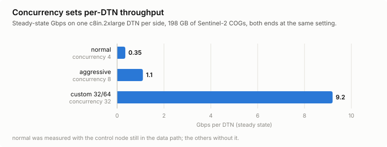

# Getting maximum performance to and from Elastic GCS endpoints

Elastic GCS endpoints run on AWS and scale out data transfer nodes (DTNs) on
demand. Our side is tuned for high concurrency. How fast *your* transfer goes
depends mostly on two things you control:

- the settings of the endpoint on your side;
- the shape of the data you move.

Both are covered below, for researchers and for the admins who run the endpoint
on the other side. All numbers are measured; see [methodology](methodology.md).

## For researchers

### Put many files in one task, or run several tasks

Globus moves several files at once, one process per file ("concurrency"). The
number in flight is set when the task starts, from both endpoints' settings.

- **A task with many files in the tens-to-hundreds-of-MB range scales best.** At
  ~0.3 Gbps per file in flight, 32 files in flight is about 9 Gbps.
- **Very large datasets: split them across several tasks.** That's by
  directory, or by date range. One task can use at most 128 files in flight,
  about 4 of our DTNs' worth. Concurrent tasks use the rest: two tasks on 8 DTNs
  ran twice as fast as one.
- **A task with fewer files than the concurrency can't use it.** Ten files means
  at most ten in flight.

### Package tiny files; split huge ones

| What you have | What happens | What to do |
|---|---|---|
| Hundreds of thousands of files under ~1 MB | Per-file overhead dominates: ~175 files/s. Writing them quickly into one new S3 prefix triggers S3 throttling, and Globus pauses the task (`ENDPOINT_TOO_BUSY`) | Bundle into archives (tar/zip, or a format with larger chunks) before transfer when you can. When writing to our S3 collections, spread output across several top-level prefixes |
| A few files of 100 GB+ | Each file moves as one stream at about **75 MB/s** (0.6 Gbps), whatever the instance size | Split into parts (e.g. `split -b 5G`) so several move at once. A 111 GB file takes ~25 min whole, or ~2 min as 32 parts on one DTN per side |
| Many files of 10 MB–1 GB | The sweet spot: ~0.3 Gbps per file in flight | Nothing to do |

### Keep checksum verification on

Verifying checksums cost about 3.5% in our tests (12.2 vs 11.8 Gbps). Turning it
off buys almost nothing and gives up integrity checking.

### If your transfer is slow

1. **Check where you're transferring to or from.** A personal endpoint (Globus
   Connect Personal) or a campus endpoint at default settings will cap the task
   at roughly 1 Gbps. Ask its admin about the settings in the next section.
2. **Look at the task's file count and sizes.** Most slow transfers are a handful
   of huge files, or a flood of tiny ones.
3. **Split a big dataset into a few concurrent tasks.**

## For endpoint administrators (the other side)

### Raise your endpoint's network use

The single biggest lever. Globus picks each task's concurrency as the **lower**
of the two endpoints' maximum concurrency:

| Your endpoint's `network_use` | Files in flight (measured) | Throughput to us, one task (measured) |
|---|---|---|
| `normal` (the default) | 4 | ~1.1 Gbps |
| `aggressive` | 8, re-tuned up to 24 mid-task | ~1.6 Gbps |
| `custom`, max concurrency 32–64 | 32 | ~4.8 Gbps on 35 GB; 6–17 Gbps on larger tasks |

Per DTN, with both ends at the same setting:



On GCS v5.4:

```bash
globus-connect-server endpoint update --network-use custom \
  --preferred-concurrency 32 --max-concurrency 64 \
  --preferred-parallelism 8 --max-parallelism 16
```

Size it to what your DTNs, storage and network can actually sustain: concurrency
is processes on *your* nodes too. Transfer rejects a max concurrency above 128.
Network use can also be overridden per storage gateway, which is useful when one
gateway serves very small files.

### Latency and parallelism

At concurrency 32, adding up to 80 ms of round-trip time made no measurable
difference, even at parallelism 1. Many concurrent streams plus Linux TCP
autotuning absorb it. Globus also raises concurrency on high-latency paths by
itself: a `normal` peer got 8 instead of 4 at +80 ms. Parallelism matters most
when concurrency is low, so raise concurrency first.

### Multi-node endpoints

Globus spreads a task's files across all *active* nodes in your endpoint, evenly.
A slow node in the set (an undersized management node, for example) gets the same
share as a fast one and becomes the bottleneck. Keep management-only hosts out of
the data path (`globus-connect-server node update <id> --disable`), but never
disable the last active node.
